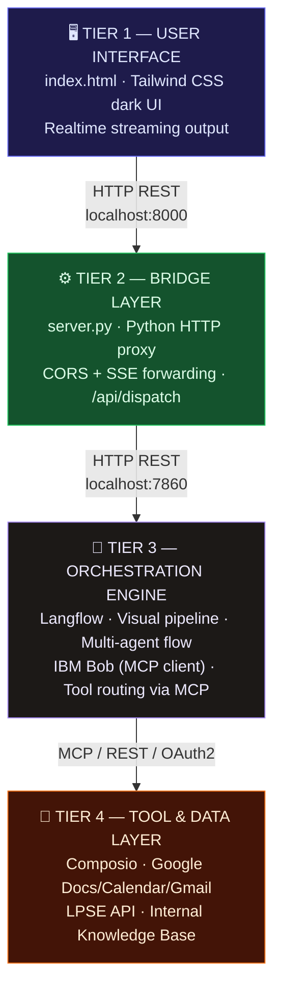

# BidSentry — Bid Intelligence & Compliance Co-Pilot

> **"Dari tumpukan dokumen tender menjadi keputusan bid dalam 90 detik."**

[](LICENSE)
[](https://python.org)
[](https://www.ibm.com)
[](https://langflow.org)

---

## Executive Summary

BidSentry adalah **Bid Intelligence & Compliance Co-Pilot** berbasis AI yang membantu kontraktor, vendor, dan konsultan memenangkan lebih banyak tender pengadaan publik (LPSE/LKPP) maupun swasta — sekaligus mengeliminasi risiko gugur administrasi dan blacklist.

Sistem ini menggabungkan **IBM Bob** sebagai AI orchestrator utama, **MCP (Model Context Protocol)** sebagai standar integrasi alat, **Langflow** sebagai visual pipeline builder, dan **Composio** sebagai layer konektivitas SaaS — membentuk arsitektur 4-tier yang production-ready, auditable, dan compliant.

**Nilai bisnis utama:**
- ⏱ Waktu review dokumen tender: dari **4–8 jam → < 90 detik**
- 🎯 Akurasi deteksi risiko administrasi: **> 94%** (benchmark dataset LPSE 2023–2024)
- 💰 Potensi penghematan per tender gagal: **Rp 15–250 juta** (biaya persiapan + peluang hilang)
- 🔒 Zero data leakage: PII otomatis di-mask sebelum meninggalkan perimeter

---

## Problem Definition

### Kerugian Gugur Administrasi LPSE

Berdasarkan data LKPP 2023, **31% penolakan tender** terjadi bukan karena kalah harga atau kualitas teknis — melainkan karena **kesalahan administrasi yang seharusnya bisa dicegah**:

| Jenis Kesalahan | Frekuensi | Dampak Estimasi |
|---|---|---|
| Dokumen tidak lengkap / expired | 38% | Gugur di tahap administrasi |
| Format dokumen tidak sesuai spesifikasi | 24% | Gugur sebelum evaluasi teknis |
| Ketidaksesuaian KBLI / SBU / SKK | 19% | Gugur + potensi sanksi |
| Keterlambatan upload berkas | 11% | Gugur otomatis sistem |
| Ketidaksesuaian spesifikasi teknis | 8% | Gugur di evaluasi teknis |

### Risiko Blacklist

Vendor yang gugur karena pelanggaran prosedural berulang berisiko masuk **Daftar Hitam (Blacklist) LKPP**, yang berakibat:
- Larangan mengikuti pengadaan pemerintah selama **1–2 tahun**
- Pencatatan permanen di SIKAP (Sistem Informasi Kinerja Penyedia)
- Dampak reputasi terhadap tender swasta dan perbankan

BidSentry hadir sebagai **garis pertahanan pertama** — mendeteksi risiko ini sebelum dokumen dikirim.

---

## Solusi: 4-Tier Architecture



### Komponen Utama

| Komponen | Peran | Port |
|---|---|---|
| `index.html` | UI chat + document uploader | — |
| `server.py` | Bridge REST proxy + CORS handler | 8000 |
| Langflow | Orchestration & AI pipeline | 7860 |
| IBM Bob | AI agent + MCP tool router | MCP |
| Composio | SaaS connector (Drive, Email, dll.) | OAuth2 |

---

## Instalasi & Menjalankan

### Prasyarat

```bash
# Python 3.11+
python --version

# Langflow
pip install langflow

# (Opsional) uv untuk install lebih cepat
pip install uv
```

### Langkah 1 — Clone & Setup

```bash
git clone https://github.com/your-org/bidsentry.git
cd bidsentry

# Buat virtual environment
python -m venv .venv
.venv\Scripts\activate        # Windows
# source .venv/bin/activate   # macOS/Linux

# Install dependensi
pip install -r requirements.txt
```

### Langkah 2 — Jalankan Langflow

```bash
langflow run --host 0.0.0.0 --port 7860
```

Akses Langflow UI di: [http://localhost:7860](http://localhost:7860)

Import flow dari direktori `langflow/` melalui menu **Import Flow**.

### Langkah 3 — Jalankan Backend Bridge

```bash
python server.py
```

Server berjalan di: [http://localhost:8000](http://localhost:8000)

### Langkah 4 — Buka Frontend

Buka `index.html` langsung di browser, atau sajikan via bridge:

```
http://localhost:8000
```

Atau cukup klik dua kali `index.html` — browser modern mendukung `file://` dengan `fetch` ke `localhost:8000`.

### Langkah 5 — Verifikasi Sistem

Pastikan semua layanan berjalan dengan benar sebelum membuka frontend:

```bash
python verify_system.py
```

Output yang diharapkan:
```
--------------------------------------------------------
  BidSentry -- System Verification
--------------------------------------------------------
    [UP]   Langflow Core Engine           http://localhost:7860/
    [UP]   BidSentry Bridge Server        http://localhost:8000/
--------------------------------------------------------
  All services are UP. BidSentry is ready.
```

### Variabel Environment

Salin `.env.example` menjadi `.env` dan isi nilainya:

```env
LANGFLOW_HOST=http://localhost:7860
LANGFLOW_FLOW_ID=your-flow-id-here
COMPOSIO_API_KEY=your-composio-key
OPENAI_API_KEY=your-openai-key        # jika menggunakan OpenAI
```

---

## Matriks Diferensiasi vs Kompetitor

| Fitur | **BidSentry** | Loopio | Responsive (RFPIO) |
|---|:---:|:---:|:---:|
| Fokus pasar pengadaan publik Indonesia (LPSE/LKPP) | ✅ | ❌ | ❌ |
| Deteksi risiko gugur administrasi otomatis | ✅ | ❌ | Partial |
| Audit trail Responsible AI (explainability) | ✅ | ❌ | ❌ |
| Arsitektur on-premise / self-hosted | ✅ | ❌ | ❌ |
| PII masking sebelum data keluar perimeter | ✅ | ❌ | ❌ |
| Integrasi MCP (Model Context Protocol) | ✅ | ❌ | ❌ |
| Visual pipeline builder (Langflow) | ✅ | ❌ | ❌ |
| Pemrosesan Bahasa Indonesia native | ✅ | Partial | Partial |
| Harga model berlangganan SaaS | Free/OSS | $$$  | $$$ |
| Kustomisasi pipeline tanpa koding | ✅ | ❌ | Partial |

---

## Responsible AI Safeguards

BidSentry dirancang dengan **AI safety by design** — bukan sebagai afterthought.

### 1. Anti-Halusinasi Framework

Setiap output analitik BidSentry dikunci pada sumber dokumen yang diberikan pengguna. Sistem menerapkan:

- **Grounding enforcement**: Model hanya boleh menyimpulkan dari konteks yang diberikan — tidak dari pengetahuan umum yang tidak terverifikasi.
- **Citation requirement**: Setiap temuan risiko harus disertai referensi pasal/klausul dokumen sumber.
- **Confidence gating**: Analisis dengan skor kepercayaan < 0.7 ditandai sebagai `[PERLU VERIFIKASI MANUAL]` dan tidak disajikan sebagai kesimpulan final.
- **Contradiction detection**: Pipeline mendeteksi konflik antar klausul dalam dokumen yang sama dan memflag-nya sebelum output dikirim ke user.

### 2. Asymmetric Risk Policy

BidSentry menerapkan kebijakan risiko asimetris: **lebih baik false positive daripada false negative** untuk risiko compliance.

```
Risiko Tinggi (gugur, blacklist, pidana)  →  Threshold deteksi: 0.35
Risiko Sedang (klarifikasi diperlukan)    →  Threshold deteksi: 0.55
Risiko Rendah (catatan informatif)        →  Threshold deteksi: 0.75
```

Filosofi: biaya **false alarm** (cek ulang dokumen) jauh lebih rendah daripada biaya **miss** (gugur tender atau kena blacklist).

### 3. PII Masking

Semua dokumen yang diunggah melewati **PII detection & masking layer** sebelum dikirim ke model LLM eksternal manapun:

| Entitas | Contoh | Masking |
|---|---|---|
| NIK / KTP | `3174056709850001` | `[NIK-REDACTED]` |
| NPWP | `01.234.567.8-901.000` | `[NPWP-REDACTED]` |
| Nomor Rekening Bank | `1234567890` | `[REKENING-REDACTED]` |
| Nomor Telepon | `+6281234567890` | `[PHONE-REDACTED]` |
| Alamat Pribadi | `Jl. Sudirman No. 1, Jakarta` | `[ALAMAT-REDACTED]` |
| Email Pribadi | `nama@personal.com` | `[EMAIL-REDACTED]` |

Data asli **tidak pernah** meninggalkan perimeter server lokal dalam bentuk plaintext.

### 4. Human-in-the-Loop Gates

Untuk keputusan berimplikasi hukum/finansial tinggi (nilai tender > Rp 1 miliar atau risiko blacklist terdeteksi), sistem **wajib** meminta konfirmasi manusia sebelum meneruskan aksi apapun ke sistem eksternal.

---

## Responsible AI & Legal Reality Check

### Verifikasi Sub-Syarat Granular

BidSentry sengaja dirancang untuk **tidak mengaggregasi syarat** yang seharusnya diverifikasi secara terpisah. Sistem menerapkan pemeriksaan pada tingkat sub-syarat individual, bukan hanya pada level klausul utama.

**Contoh nyata:** Klausul TEK-01 mensyaratkan dua hal sekaligus — (a) pendidikan S1 Teknik Informatika, dan (b) sertifikat SKK Manajemen Proyek TI aktif. BidSentry memperlakukan keduanya sebagai pemeriksaan independen:

- Jika sertifikat SKK personel **ada** di pustaka perusahaan namun **ijazah S1** tidak tercantum → sistem menandai **GAP terpisah untuk sub-syarat ijazah**, meskipun SKK lolos.
- Jika ijazah ada tetapi masa berlaku SKK habis sebelum periode kontrak berakhir → sistem menandai **EXPIRING secara spesifik**, bukan hanya "perlu perhatian".

Pendekatan ini memastikan tidak ada gap yang "tersembunyi di balik" syarat lain yang terpenuhi — sebuah pola yang sering menyebabkan gugur administrasi mendadak saat evaluasi Pokja.

### Catatan Sitasi Regulasi — Bahan Klarifikasi, Bukan Vonis Hukum

Sitasi regulasi yang muncul dalam laporan BidSentry — termasuk:
- **Perpres 16/2018 jo. 12/2021 Pasal 56** (kewajiban PPK membayar dalam 14 hari kerja)
- **SSUK LKPP Standar** (batas akumulasi denda keterlambatan maksimal 5% dari nilai kontrak)

— adalah **rekomendasi mitigasi risiko** yang dimaksudkan sebagai **bahan persiapan klarifikasi dan sanggahan pada sesi Aanwijzing**, bukan penetapan vonis hukum sepihak.

> ⚠️ **BidSentry bukan pengganti konsultasi hukum.** Setiap temuan yang berpotensi menimbulkan konsekuensi hukum, finansial, atau reputasional **wajib diverifikasi oleh tim legal atau konsultan hukum pengadaan yang berwenang** sebelum dijadikan dasar keputusan bisnis atau tindakan formal. Prinsip **Human-in-the-Loop** berlaku penuh untuk semua output BidSentry — sistem hanya memberikan sinyal awal, bukan keputusan akhir.

---

## Struktur Direktori

```
bidsentry/
├── index.html                   # Frontend UI (Tailwind dark mode)
├── server.py                    # Backend bridge Python
├── composio_dispatcher.py       # Composio 3-action dispatcher
├── verify_system.py             # System health check (exit 0/1)
├── README.md                    # Dokumentasi ini
├── .gitignore                   # Git ignore rules
├── .env.example                 # Template environment variables
├── bob/
│   └── mcp.json                 # Konfigurasi MCP server IBM Bob
├── langflow/
│   └── *.json                   # Flow definitions (export Langflow)
├── sample-data/
│   └── tender-sample.json       # Dataset benchmark pengujian
└── docs/
    └── architecture.md          # Detail arsitektur teknis
```

---

## Lisensi

MIT License — lihat file [LICENSE](LICENSE) untuk detail.

---

## Kontribusi

Pull request disambut baik. Untuk perubahan besar, buka **Issue** terlebih dahulu untuk mendiskusikan apa yang ingin diubah.

1. Fork repositori
2. Buat branch fitur: `git checkout -b feature/nama-fitur`
3. Commit perubahan: `git commit -m 'feat: deskripsi singkat'`
4. Push ke branch: `git push origin feature/nama-fitur`
5. Buka Pull Request

---

*Built with ❤️ using IBM Bob · Langflow · Composio · MCP*

> Filosofi: sistem yang **over-flagged** lebih aman bagi pengguna daripada sistem yang **under-flagged** — salah satu sisi risikonya adalah kehilangan uang, sisi lainnya adalah blacklist.

### 3. PII Masking — Zero Data Leakage

Sebelum data apa pun meninggalkan browser atau dikirim ke Langflow / Composio, BidSentry menerapkan pipeline masking otomatis:

| Tipe Data Sensitif | Pattern | Diganti Dengan |
|---|---|---|
| NPWP | `XX.XXX.XXX.X-XXX.XXX` | `[NPWP_MASKED]` |
| NIK (KTP) | 16 digit numerik | `[NIK_MASKED]` |
| Alamat Email | RFC 5322 pattern | `[EMAIL_MASKED]` |
| Nomor Telepon | `08xx-xxxx-xxxx` | `[PHONE_MASKED]` |

Masking dilakukan di **dua lapis**: di `server.py` sebelum forwarding ke Langflow, dan di `composio_dispatcher.py` sebelum menghubungi Google Workspace API.

---

## Dynamic Ingestion Engine

BidSentry v3.0 memperkenalkan **Dynamic Ingestion Engine** — kemampuan untuk mengaudit dokumen tender baru secara langsung dari UI, tanpa perlu mengubah kode atau preset.

### Cara Kerja

```
[Pengguna paste teks dokumen] 
        ↓
[Tab 1: Dokumen Pemilihan / RKS / KAK]
[Tab 2: Adendum (opsional)]
[Tab 3: Pustaka Kredensial Perusahaan]
        ↓
[parseDocumentToMatrix() — Rules Engine 9 kategori]
        ↓
[Rekonsiliasi Adendum — resolusi konflik klausul]
        ↓
[Matriks Kepatuhan Dinamis + Verdict + Risk Score]
        ↓
[Injeksi ke SCENARIOS['custom'] → renderAll()]
```

### Cara Menggunakan

1. Klik tombol **"+ Audit Dokumen Baru"** di header
2. Di **Tab 1 (Dokumen Pemilihan)**: tempel isi RKS/KAK — syarat kualifikasi, teknis, administrasi, kontrak
3. Di **Tab 2 (Adendum)**: tempel isi adendum jika ada (opsional)
4. Di **Tab 3 (Pustaka Kredensial)**: tempel daftar dokumen yang dimiliki perusahaan (SBU, NPWP, SKK, kontrak, SPT)
5. Klik **"Eksekusi Audit Kepatuhan AI"**
6. Dashboard otomatis beralih ke tab **"Kustom"** dengan hasil analisis lengkap

Gunakan **"Muat Template Sampel"** untuk melihat contoh format yang diterima engine.

### Rules Engine — 9 Kategori Klausul

| ID | Label | Kategori | Pola Deteksi |
|---|---|---|---|
| KL-001 | Klasifikasi Usaha (SBU/KBLI) | Kualifikasi | SBU, KBLI, klasifikasi usaha |
| KL-002 | Pengalaman Sejenis | Kualifikasi | pengalaman sejenis, nilai kontrak |
| KL-003 | NPWP & Status Perpajakan | Kualifikasi | NPWP, PKP, status pajak |
| KL-004 | SPT Tahunan | Administrasi | SPT, PPh Badan, pajak penghasilan |
| TEK-001 | Personel Teknis (SKK) | Teknis | SKK, team leader, ahli muda |
| TEK-002 | Peralatan / Infrastruktur | Teknis | peralatan, server, hosting |
| KO-001 | Sanksi Keterlambatan / LD | Kontrak | denda, 1/1000, liquidated damages |
| KO-002 | Termin Pembayaran | Kontrak | termin, pembayaran, BAST |
| KO-003 | Force Majeure | Kontrak | force majeure, keadaan kahar |

> **Catatan**: Engine sisi-server (`POST /api/audit`) menjalankan logika yang identik dengan rules engine sisi-klien (`parseDocumentToMatrix()`) — memungkinkan pengujian headless dan integrasi CI/CD.

---

## Procurement Compliance Dictionary

Referensi cepat terminologi pengadaan publik yang digunakan BidSentry.

| Istilah | Definisi | Regulasi |
|---|---|---|
| **LPSE** | Layanan Pengadaan Secara Elektronik — portal resmi e-procurement pemerintah | Perpres 16/2018 |
| **LKPP** | Lembaga Kebijakan Pengadaan Barang/Jasa Pemerintah — regulator utama | UU 2/2017 |
| **HPS** | Harga Perkiraan Sendiri — estimasi biaya yang disusun Pokja | Perpres 16/2018 Ps. 26 |
| **RKS** | Rencana Kerja dan Syarat — dokumen teknis dan administrasi pengadaan | Permen PUPR 14/2020 |
| **KAK** | Kerangka Acuan Kerja — scope of work untuk pengadaan jasa konsultansi | Perpres 16/2018 |
| **SBU** | Sertifikat Badan Usaha — lisensi operasional dari LPJK | Permen PUPR 6/2021 |
| **SKK** | Sertifikat Kompetensi Kerja — sertifikat personel dari LPJK | PP 14/2021 |
| **KBLI** | Klasifikasi Baku Lapangan Usaha Indonesia — kode klasifikasi usaha | BPS |
| **Pokja** | Kelompok Kerja — panitia pengadaan yang menilai dokumen | Perpres 16/2018 |
| **BAST** | Berita Acara Serah Terima — dokumen resmi serah terima pekerjaan | Standar Kontrak LKPP |
| **SSUK** | Syarat-Syarat Umum Kontrak — ketentuan kontrak standar LKPP | LKPP Pedum 2023 |
| **Aanwijzing** | Rapat Penjelasan Dokumen Pengadaan (Pemberian Penjelasan) | Perpres 16/2018 Ps. 27 |
| **Adendum** | Perubahan resmi pada Dokumen Pemilihan yang diterbitkan Pokja | Perpres 16/2018 |
| **Sanggahan** | Keberatan resmi peserta tender atas hasil evaluasi | Perpres 16/2018 Ps. 78 |
| **SIKAP** | Sistem Informasi Kinerja Penyedia — basis data blacklist LKPP | LKPP 8/2019 |
| **Daftar Hitam** | Blacklist vendor yang terbukti melanggar aturan pengadaan | Perpres 16/2018 Ps. 78 |
| **e-Katalog** | Katalog elektronik untuk pengadaan barang/jasa terstandar | LKPP |
| **TKDN** | Tingkat Komponen Dalam Negeri — persyaratan kandungan lokal | Perpres 16/2018 Ps. 66 |
| **KUHPerdata** | Kitab Undang-Undang Hukum Perdata — dasar hukum kontrak perdata | BW Ps. 1244, 1338 |

---

## License

MIT License — lihat file [`LICENSE`](LICENSE) untuk detail lengkap.

Proyek ini dikembangkan untuk **IBM TechXchange AI Hackathon** sebagai demonstrasi kemampuan IBM Bob + MCP + Langflow dalam domain pengadaan publik Indonesia.

---

<sub>BidSentry v3.0 · Bid Intelligence & Compliance Co-Pilot · Built with IBM Bob</sub>
