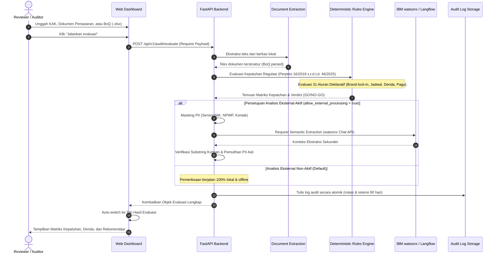

# Arsitektur Sistem BidSentry

Dokumen ini mendokumentasikan arsitektur teknis sistem BidSentry v4.2, mencakup topologi modul, diagram alir data, urutan proses (sequence diagram), dan titik integrasi eksternal termasuk IBM watsonx / Bob MCP.

---

## 1. Topologi Arsitektur (Flowchart Diagram)

```mermaid
flowchart TD
    subgraph UI["Frontend (Browser / Vanilla JS)"]
        A["Pengguna Unggah Dokumen\n(PDF / DOCX / XLSX / TXT)"] --> B["Upload & Preview Manager\n(web/app.js)"]
        B --> C["Tampilan Matriks & Triage\n(web/render.js & web/review.js)"]
        C --> D["Sanggahan Builder & Ekspor\n(DOCX / TXT / Excel)"]
    end

    subgraph BACKEND["Backend Server (FastAPI / ASGI)"]
        E["API Gateway & Route Guards\n(Token Auth, DNS Rebinding Guard)"]
        F["Document Extraction Service\n(PDF Plumber, DOCX, openpyxl)"]
        G["PII Masking Engine\n(NIK, NPWP, Rekening, Telp)"]
        H["Deterministic Rules Engine\n(bidsentry/evaluators/engine.py)"]
        I["Forensic Reconciliation Engine\n(Addendum Diff & Contract Diff)"]
        J["Rules Loader\n(config/rules.yaml)"]
        K["Atomic Audit Logger\n(bidsentry/lib/audit_log.py)"]
    end

    subgraph IBM_EXT["Integrasi Layanan Eksternal & IBM"]
        L["IBM watsonx.ai Foundation Models\n(Chat API)"]
        M["Bob MCP Server\n(bob/mcp.json - Transport: stdio)"]
        N["Langflow Orchestrator\n(Local Port 7860)"]
        O["Composio Automation\n(Google Docs / Calendar)"]
    end

    B -->|REST API Request| E
    E --> F
    F -->|Teks Terekstraksi| G
    G -->|Teks Bersih| H
    J -->|Threshold & RegEx| H
    H --> I
    I --> K
    K -->|Payload Hasil Audit| C

    G -.->|Optional Advisory (Consent Given)| L
    G -.->|Advisory Flow| N
    N -.->|Tool Calls| M
    C -.->|Tindak Lanjut Reviewer| O
```

---

## 2. Diagram Urutan Evaluasi Dokumen (Sequence Diagram)



---

## 3. Titik Integrasi Teknologi IBM (IBM Touchpoints)

1. **IBM watsonx.ai Foundation Models**:
   - Terintegrasi pada modul `bidsentry/services/langflow_service.py` (`_run_watsonx_json`).
   - Menggunakan model chat watsonx (default `mistralai/mistral-small-3-1-24b-instruct-2503`) untuk penelaahan semantik dokumen kompleks (seperti sertifikasi personel TI dan komitmen SLA).
   - Seluruh pemanggilan model dipagari oleh modul sensor PII (`bidsentry/lib/pii.py`) guna menjamin data identitas sensitif tidak ditransmisikan.

2. **IBM Bob / Model Context Protocol (MCP)**:
   - Dikonfigurasi dalam file `bob/mcp.json`.
   - Mengikuti spesifikasi resmi Model Context Protocol melalui `stdio` transport.
   - Menyediakan antarmuka standar agar agen pengembang pintar (IBM Bob atau IDE kompatibel MCP) dapat memanggil flow audit dan integrasi BidSentry secara native.

---

## 4. Keamanan dan Isolasi Data
- **Host Header & DNS Rebinding Guard**: Permintaan API dibatasi secara ketat hanya untuk host lokal terpercaya (`localhost`, `127.0.0.1`, atau host yang terdaftar dalam `BIDSENTRY_ALLOWED_HOSTS`).
- **Autentikasi Token**: Operasi administratif dan konfigurasi sensitif dilindungi dengan bearer token internal (`BIDSENTRY_ACCESS_TOKEN`).
- **Penyimpanan Bebas Teks Asli di Frontend**: Frontend tidak menyimpan teks dokumen mentah atau kredensial pengguna di `localStorage` peramban. State disimpan aman di dalam memori runtime sesi aktif.

---

## 5. Titik Masuk Server

| Berkas | Peran |
| :--- | :--- |
| `server.py` | Peluncur CLI (`python server.py`); menolak start di host non-loopback tanpa `BIDSENTRY_ACCESS_TOKEN`. |
| `bidsentry/asgi.py` | Aplikasi FastAPI: middleware keamanan (host guard, token, rute sensitif, header CSP), file statis, dan dispatcher API. |
| `bidsentry/app.py` | Kontainer dependensi (`create_application`) yang merangkai seluruh layanan. |
| `bidsentry/api/routes.py` | Dispatcher `ApiRouter` dengan kontrak respons Pydantic (`bidsentry/schemas/api.py`) dan pembatasan peran Pokja/Vendor. |
| `bidsentry/api/jobs_router.py` | **Opsional.** Antrean audit asinkron (ARQ + Redis + SQLAlchemy) dan stream SSE. Hanya aktif bila `BIDSENTRY_JOB_ENGINE=redis` dan paket `requirements-jobs.txt` terpasang; antarmuka web tidak membutuhkannya. |

## 6. Modul Kanonikal (Sumber Kebenaran Tunggal)

| Kategori | Modul | Keterangan |
| :--- | :--- | :--- |
| **Mesin aturan** | `bidsentry.evaluators.engine` | Evaluasi deterministik 31 aturan dari `rule_catalog.py`; ambang angka di `config/rules.yaml`. |
| **Keputusan risiko** | `bidsentry.services.risk_engine` | Tabel keputusan R0–R6 → Rendah / Sedang / Tinggi / Kritis dan verdict GO / NO-GO / BELUM CUKUP BUKTI. |
| **Audit finansial** | `bidsentry.audits.financial`, `penalty_calculator`, `excel_parser` | Aritmetika BoQ, batas denda, dan parser Excel. |
| **Layanan audit** | `bidsentry.services.audit_service` | Fasad `.audit()` (aturan) dan `.audit_comprehensive()` (modul forensik). |
| **Jejak audit** | `bidsentry.lib.audit_log` | Log hash-chained; ProofLog per audit menampilkan langkah input → PII → AI → validasi → hitungan → keputusan → dokumen. |
| **Integrasi AI** | `bidsentry.services.watsonx_service`, `langflow_service` | Chat API IBM watsonx.ai (model via `WATSONX_MODEL_ID`) dengan sensor PII sebelum transmisi; hasil AI hanya kandidat kutipan yang divalidasi ulang Python. |
| **Dokumen keluaran** | `bidsentry.generators.*`, `services.boq_export_service` | Naskah dinas DOCX (BA, klarifikasi, sanggahan) dan BoQ XLSX. |
