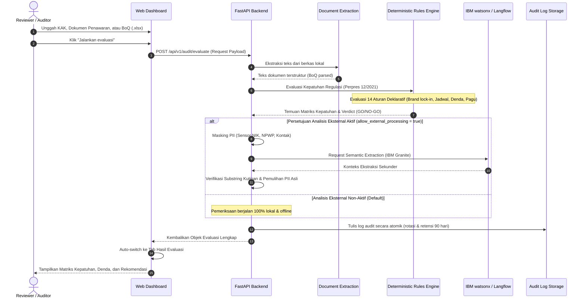

# Arsitektur Sistem BidSentry

Dokumen ini mendokumentasikan arsitektur teknis sistem BidSentry v2.1, mencakup topologi modul, diagram alir data, urutan proses (sequence diagram), dan titik integrasi eksternal termasuk IBM watsonx / Bob MCP.

---

## 1. Topologi Arsitektur (Flowchart Diagram)

```mermaid
flowchart TD
    subgraph UI["Frontend (Browser / Vanilla JS)"]
        A["Pengguna Unggah Dokumen\n(PDF / DOCX / XLSX / TXT)"] --> B["Upload & Preview Manager\n(web/app.js)"]
        B --> C["Tampilan Matriks & Triage\n(web/render.js & web/review.js)"]
        C --> D["Sanggahan Builder & Ekspor\n(DOCX / TXT / Excel)"]
    end

    subgraph BACKEND["Backend Server (FastAPI / ASGI)"]
        E["API Gateway & Route Guards\n(Token Auth, DNS Rebinding Guard)"]
        F["Document Extraction Service\n(PDF Plumber, DOCX, openpyxl)"]
        G["PII Masking Engine\n(NIK, NPWP, Rekening, Telp)"]
        H["Deterministic Rules Engine\n(bidsentry/evaluators/engine.py)"]
        I["Forensic Reconciliation Engine\n(Addendum Diff & Contract Diff)"]
        J["Rules Loader\n(config/rules.yaml)"]
        K["Atomic Audit Logger\n(bidsentry/lib/audit_log.py)"]
    end

    subgraph IBM_EXT["Integrasi Layanan Eksternal & IBM"]
        L["IBM watsonx.ai Foundation Models\n(IBM Granite-3-8b-instruct)"]
        M["Bob MCP Server\n(bob/mcp.json - Transport: stdio)"]
        N["Langflow Orchestrator\n(Local Port 7860)"]
        O["Composio Automation\n(Google Docs / Calendar)"]
    end

    B -->|REST API Request| E
    E --> F
    F -->|Teks Terekstraksi| G
    G -->|Teks Bersih| H
    J -->|Threshold & RegEx| H
    H --> I
    I --> K
    K -->|Payload Hasil Audit| C

    G -.->|Optional Advisory (Consent Given)| L
    G -.->|Advisory Flow| N
    N -.->|Tool Calls| M
    C -.->|Tindak Lanjut Reviewer| O
```

---

## 2. Diagram Urutan Evaluasi Dokumen (Sequence Diagram)



---

## 3. Titik Integrasi Teknologi IBM (IBM Touchpoints)

1. **IBM watsonx.ai Foundation Models**:
   - Terintegrasi pada modul `bidsentry/services/langflow_service.py` (`_run_watsonx_json`).
   - Menggunakan model `ibm/granite-3-8b-instruct` untuk penelaahan semantik dokumen kompleks (seperti sertifikasi personel TI dan komitmen SLA).
   - Seluruh pemanggilan model dipagari oleh modul sensor PII (`bidsentry/lib/pii.py`) guna menjamin data identitas sensitif tidak ditransmisikan.

2. **IBM Bob / Model Context Protocol (MCP)**:
   - Dikonfigurasi dalam file `bob/mcp.json`.
   - Mengikuti spesifikasi resmi Model Context Protocol melalui `stdio` transport.
   - Menyediakan antarmuka standar agar agen pengembang pintar (IBM Bob atau IDE kompatibel MCP) dapat memanggil flow audit dan integrasi BidSentry secara native.

---

## 4. Keamanan dan Isolasi Data
- **Host Header & DNS Rebinding Guard**: Permintaan API dibatasi secara ketat hanya untuk host lokal terpercaya (`localhost`, `127.0.0.1`, atau host yang terdaftar dalam `BIDSENTRY_ALLOWED_HOSTS`).
- **Autentikasi Token**: Operasi administratif dan konfigurasi sensitif dilindungi dengan bearer token internal (`BIDSENTRY_ACCESS_TOKEN`).
- **Penyimpanan Bebas Teks Asli di Frontend**: Frontend tidak menyimpan teks dokumen mentah atau kredensial pengguna di `localStorage` peramban. State disimpan aman di dalam memori runtime sesi aktif.
